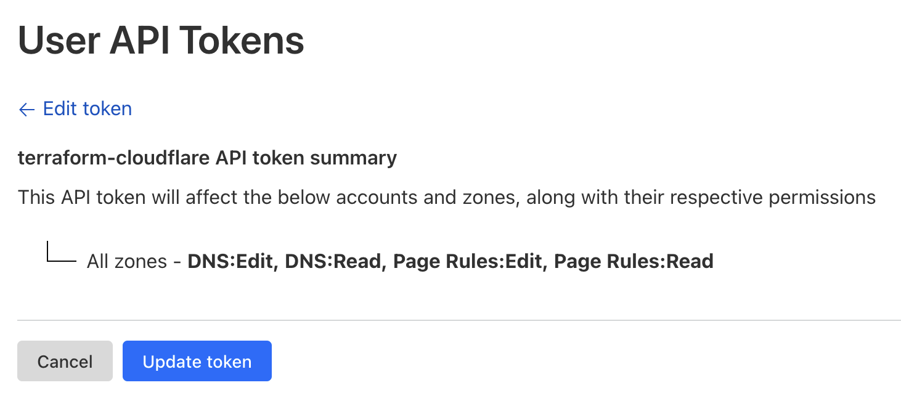

This project has been bootstraped using [terraform-aws-github-workspace](https://github.com/Gloweet/terraform-aws-github-workspace).

# How to set the Cloudflare API Token
If using Cloudflare, you need to retrieve an API Token with the following permissions:
- Manage DNS Zone
- Manage Page Rules
- Edit DNS Records

1. Go to the dashboard, then Profile > [API Tokens](https://dash.cloudflare.com/profile/api-tokens)
2. Click on Create Token
3. Select Custom Token
4. Name the token, e.g. "terraform-cloudflare"
5. Select the following permissions:
   - Zone > Zone > Read
   - Zone > DNS > Read
   - Zone > DNS > Edit
   - Zone > Page Rules > Read
   - Zone > Page Rules > Edit
6. Select Zone Resources: Include Specific Zone and select your domain
7. Click on Continue to summary
8. Click on Create Token
9. Copy the token and set it as the `cloudflare_api_token` variable in your Terraform configuration

You should see the following output:

